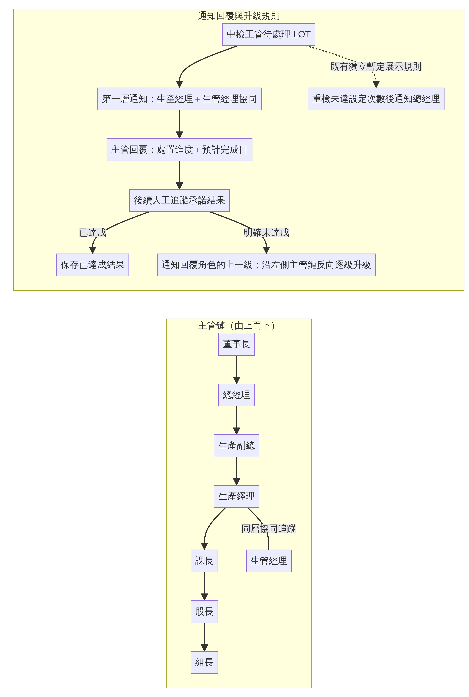
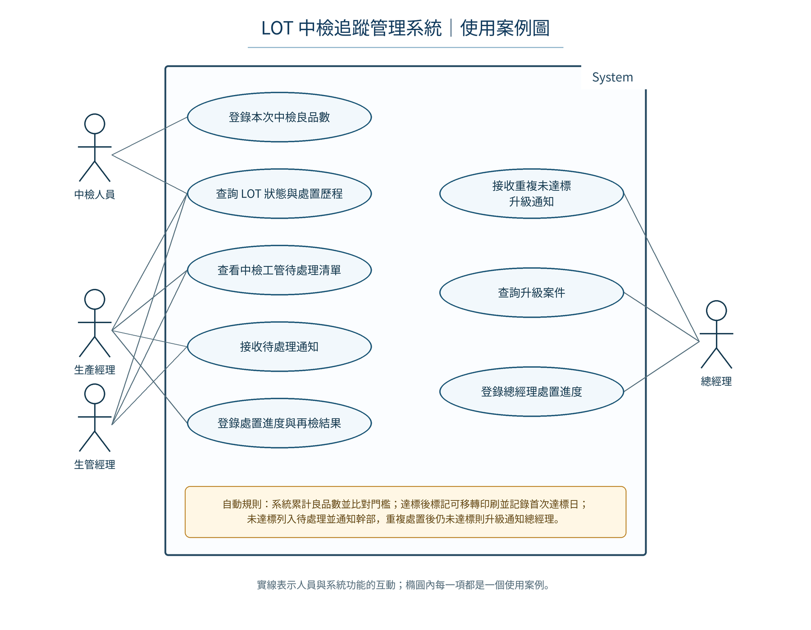
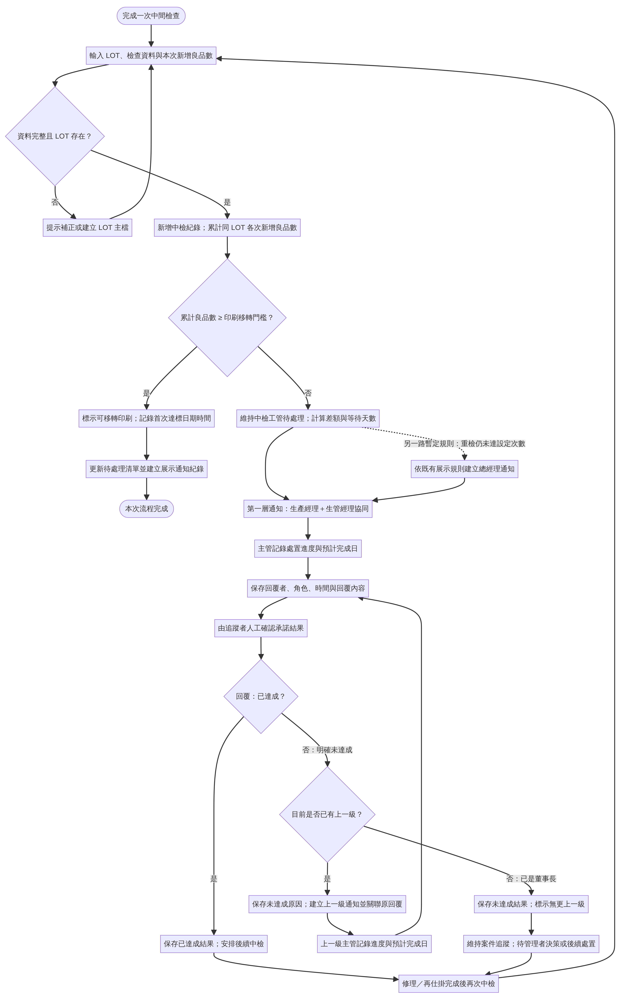
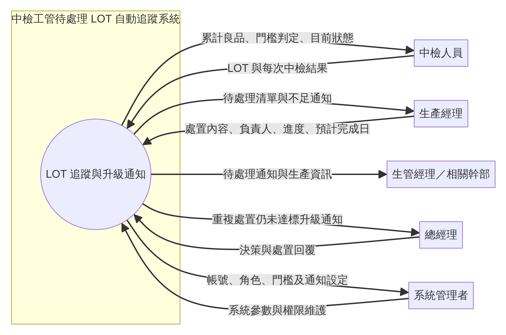
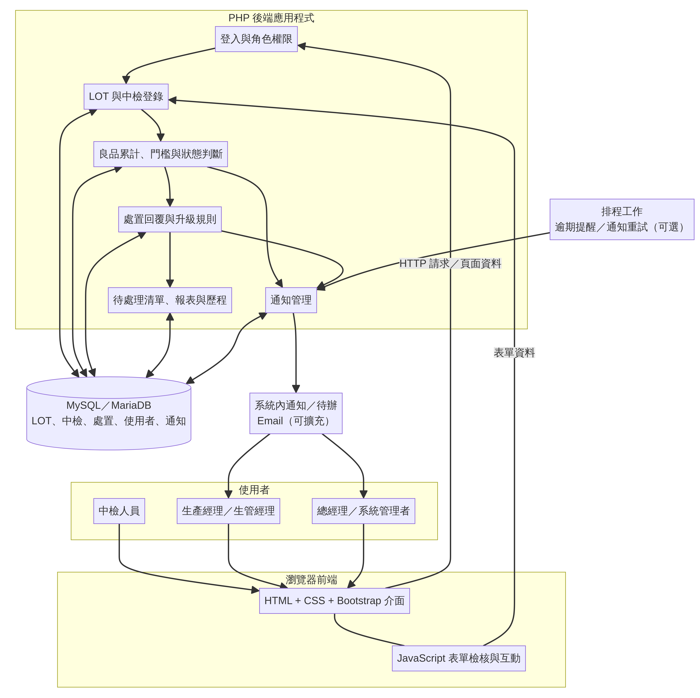
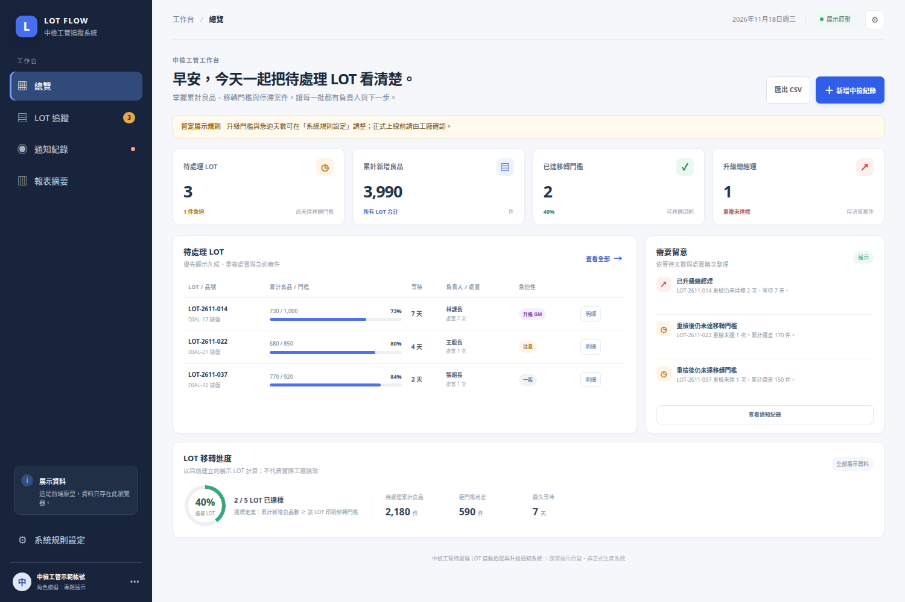
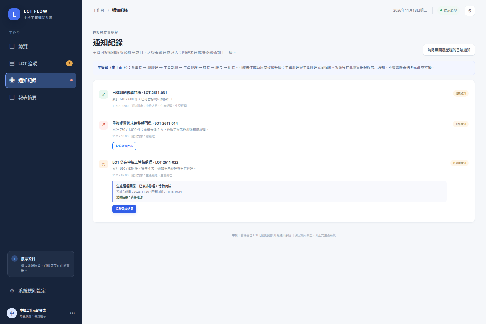
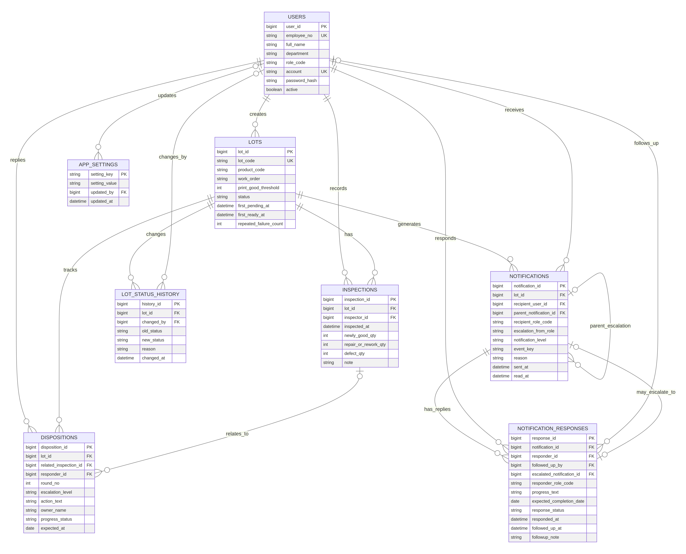

# 中檢工管待處理 LOT 自動追蹤與升級通知系統

## 系統分析與設計專題報告

**班級／課程：** ____________________  
**姓名：** ____________________　　**學號／座號：** ____________________  
**指導老師：** ____________________  
**日期：** 2026 年 11 月

---

## 摘要

本專題針對錶面工廠中間檢查後的待處理 LOT 管理問題，規劃並製作一套追蹤與升級通知系統。產品經過前段製程後會進入中檢；如果累計良品數尚未達到印刷移轉門檻，LOT 需留在「中檢工管」等待修理品或再仕掛品完成，再次檢查後把本次新增良品數加入累計。現有手寫流程資料指出，LOT 數量多、待修案件及重複處置案件需要持續追蹤，容易因人工記憶或訊息分散而延遲處理。

本系統以「每次中檢只登錄本次新增良品數」為核心，依 LOT 設定的移轉門檻自動計算累計數、差額、達成率與狀態。未達標的 LOT 留在待處理清單，顯示負責人、等待天數、處置及重檢次數；第一層通知由生產經理與生管經理協同追蹤。接到通知的主管須記錄處置進度及預計完成日，之後明確追蹤承諾是否達成；若回覆未達成，系統依主管鏈通知上一級並保留原回覆、追蹤結果與升級關聯。既有「重檢多次仍未達標後通知總經理」另保留為暫定展示規則。達標後系統記錄首次達標時間，標示為「可移轉印刷」。

本次完成系統分析報告、流程與資料庫設計，以及可在瀏覽器操作的前端展示原型。原型支援新增中檢、良品累計、門檻判定、主管回覆進度與預計完成日、後續確認承諾結果、未達成逐級升級模擬、篩選及 CSV 匯出；7 項 Node.js 通知流程單元測試皆通過。資料僅存在瀏覽器 LocalStorage，尚未連接正式 PHP／MySQL 後端，也不會實際寄送電子郵件或推播。報告中的 LOT、數量及急迫規則皆為展示用資料或暫定設定，不代表工廠實際績效或已核定規範。

**關鍵詞：** LOT 追蹤、中間檢查、良品累計、移轉門檻、待處理管理、升級通知

## 目錄

1. 概述
2. 使用者需求分析
3. 系統分析
4. 系統設計
5. 原型實作與測試
6. 預期效益與未來工作
7. 結論
8. 參考資料

---

# 一、概述

## 1.1 專題動機與問題描述

本專題題目來自提供的錶面工廠流程與手寫筆記。整體製程圖包含前段生產、修理、中檢及後續移轉；本專題並不打算涵蓋全部生產設備或每一站的派工，而是聚焦在**中檢完成後，累計良品是否達到印刷移轉門檻**這個明確問題。依提供的情境資料，現場每日可能有約 150 至 200 個 LOT 流動；此數字為專題情境說明，尚非本系統量測結果。

手寫流程圖中的 P 檢查至裁切線屬生產流程背景；本系統範圍仍聚焦在中檢後 LOT 良品累計及印刷移轉門檻，不負責管理 P 檢查或裁切作業。

目前的管理痛點可整理為：

1. 每個 LOT 的品項及印刷移轉良品門檻可能不同，人工查找與計算不容易一眼確認。
2. 同一 LOT 會分次完成中檢，每次新增良品數需要累計；若重複輸入既有良品，會造成數量錯誤。
3. 未達標的 LOT 需等待修理或再仕掛，管理者需要知道等待多久、目前由誰負責及下一步為何。
4. 多次修理／再仕掛並再次中檢仍不足時，案件容易停滯，應讓主管依規則及時介入。
5. 主管收到通知後的處置進度與預計完成日若未記錄，承諾是否達成便難以追蹤。
6. 回覆未達成時需通知上一級；若回覆、追蹤結果及升級通知分散在紙本或訊息中，事後不易還原完整歷程。

因此，本專題把複雜的製程背景縮小成一個可實作的管理閉環：**中檢登錄 → 良品累計 → 門檻判斷 → 通知處置回覆（進度、預計完成日）→ 追蹤承諾結果 → 未達成則逐級升級 → 達標可移轉。**

## 1.2 專題目標與價值

本系統的目標是讓每個未達門檻的 LOT 都「看得到、有人負責、有進度可追」；反覆處置仍未達標時能依條件升級提醒；達標後留下可查證的時間與中檢明細。預期價值如下：

- **減少人工加總錯誤：**每次只登錄本次新增良品，系統統一累加。
- **縮短發現停滯的時間：**待處理清單可依等待天數、急迫性及重檢次數排列。
- **清楚分配責任：**主管處置須記錄方式、負責人、進度與預計完成日。
- **提供逐級管理依據：**生產經理與生管經理協同追蹤；主管明確回覆未達成時，按已確認的主管鏈通知上一級。
- **保留檢討資料：**保存主管進度、預計完成日、承諾結果、回覆者與逐級升級通知的關聯歷程。

## 1.3 專題範圍與研究方式

本專題依使用者提供的現場流程圖、工作筆記、組織圖，以及「如何做好專題」簡報和「系統分析專案計劃書」格式範例整理需求，先界定範圍，再進行系統分析、資料庫設計與可操作原型製作。未假設已完成工廠正式訪談、上線或績效量測。

**第一版範圍包含：**LOT 主檔、每次中檢新增良品數、累計與門檻判斷、待處理清單、負責人與處置進度、主管通知回覆與預計完成日、人工追蹤承諾是否達成、未達成時逐級通知上一級並保留歷程、等待時間與重檢次數、達標時間、報表摘要及 CSV 匯出。

**第一版不包含：**電鍍／塗裝設備串接、ERP／MES 串接、修理作業本身、實際印刷派工、正式帳號驗證、正式 Email／簡訊推播、跨廠部署。這些可列為後續擴充。

---

# 二、使用者需求分析

## 2.1 使用者與利害關係人

| 角色 | 工作上的需要 | 系統中的主要操作 |
|---|---|---|
| 中檢人員 | 登錄每次檢查結果並確認累計數 | 新增 LOT／中檢紀錄、查看門檻與目前狀態 |
| 組長、股長、課長 | 執行或協調修理、再仕掛及重檢安排 | 接到通知時記錄進度與預計完成日；未達成時通知上一級 |
| 生產經理 | 負責生產處置與追蹤 | 接收第一層通知、回覆進度與預計完成日、追蹤承諾結果 |
| 生管經理 | 與生產經理協同追蹤生產安排 | 接收第一層通知並協同處置；與生產經理並列合作，不插入主管鏈 |
| 生產副總 | 督導生產經理 | 接到未達成升級通知後回覆並追蹤；其上一級為總經理 |
| 總經理 | 督導生產副總及處理既有重檢升級案件 | 查看升級原因、回覆進度與預計完成日；必要時通知董事長 |
| 董事長 | 主管鏈最高層級 | 接收總經理回覆未達成時的上一級通知；此層以上無主管可再升級 |
| 系統管理者 | 維護帳號、角色、門檻與通知規則 | 管理使用者、通知名單、急迫天數及升級次數 |

依已確認的組織層級，主管鏈為董事長 → 總經理 → 生產副總 → 生產經理 → 課長 → 股長 → 組長。生管經理與生產經理並列協同追蹤，不插入此主管鏈；生產經理或生管經理的回覆未達成時，上一級為生產副總。未達成升級依目前回覆角色逐級向上，董事長為最高層級。

## 2.2 功能性需求

| 編號 | 功能需求 | 驗收重點 |
|---|---|---|
| F01 | 新增與查詢 LOT 主檔 | LOT 編號唯一；品號、工單、移轉門檻可查詢 |
| F02 | 新增中檢紀錄 | 記錄時間、檢查數、本次新增良品、待修／再仕掛、不良數、備註及人員 |
| F03 | 自動累計良品 | 累計數為該 LOT 每筆「本次新增良品數」加總，不重複計入舊數 |
| F04 | 自動判斷移轉門檻 | 累計數達到或超過門檻時轉為「可移轉印刷」，記錄首次達標時間 |
| F05 | 維護待處理清單 | 未達標 LOT 顯示差額、等待天數、重檢未達次數、負責人及處置進度 |
| F06 | 登錄處置與通知回覆 | 記錄處置內容、負責人、目前進度、預計完成日、回覆角色及時間 |
| F07 | 產生第一層通知 | 未達門檻時建立通知事件，由生產經理與生管經理協同追蹤 |
| F08 | 重檢未達標升級（既有規則） | 再檢仍不足且達到暫定、可設定的次數時，建立總經理通知；正式門檻待確認 |
| F09 | 查詢報表及歷程 | 查看待處理、已達標、通知、回覆、追蹤結果及狀態歷程，並可輸出 LOT 明細 CSV |
| F10 | 維護系統規則 | 設定暫定重檢升級次數、注意及急迫等待天數，記錄設定異動 |
| F11 | 取消或報廢結案 | 保留原因、操作者和時間；執行角色與核准方式待現場確認 |
| F12 | 追蹤通知承諾結果及逐級升級 | 主管回覆後人工追蹤「已達成／未達成」；未達成時按主管鏈通知上一級並保留回覆與升級關聯 |

## 2.3 非功能性需求

| 類別 | 建議需求／驗收方式 |
|---|---|
| 易用性 | 中檢登錄欄位名稱清楚，將「本次新增良品」與「累計良品」分開顯示 |
| 效能 | 正式環境建議以 200 個以上 LOT 測試清單搜尋與載入時間；原型未進行正式效能測試 |
| 相容性 | 介面以桌上型瀏覽器為主並支援窄螢幕檢視；實際工作站瀏覽器需確認 |
| 權限 | 正式版依角色限制登錄、處置、系統設定及升級回覆功能 |
| 資料正確性 | 良品數不可為負；同一檢查不得重複送出；所有異動保留操作者與時間 |
| 資訊安全 | 正式版應使用登入驗證、角色授權、HTTPS、伺服器端輸入驗證及參數化 SQL |
| 可追溯性 | 保存中檢、處置、通知、狀態與設定的歷程，不以直接覆寫取代歷程 |
| 可維護性 | 升級次數與急迫天數為設定值，不寫死在程式規則中 |

---

# 三、系統分析

## 3.1 系統使用案例

系統主要使用案例包括「中檢人員新增檢查紀錄」、「系統累計並判斷」、「主管回覆通知進度與預計完成日」、「追蹤者確認承諾是否達成並對未達成逐級升級」、「生產經理與生管經理協同追蹤」及「管理者維護參數」。

## 3.2 主要使用案例說明

### UC-01 新增中檢紀錄

- **主要角色：**中檢人員。
- **前置條件：**LOT 主檔存在，且使用者有中檢登錄權限。
- **基本流程：**選擇 LOT → 填寫本次新增良品數及檢查資訊 → 系統驗證資料 → 新增中檢紀錄 → 系統重新加總 → 顯示累計、差額與狀態。
- **例外流程：**LOT 不存在、數量不是非負整數或必填欄位缺漏時，提示修正且不寫入資料。
- **後置條件：**中檢明細被保留；達標則記錄首次達標時間，未達標則出現在待處理清單。

### UC-02 更新處置與通知回覆

- **主要角色：**接獲通知的主管；生產經理與生管經理為第一層協同追蹤角色。
- **前置條件：**存在尚待處理的通知。
- **基本流程：**開啟通知 → 選擇回覆層級 → 記錄目前進度與預計完成日 → 儲存；之後再次追蹤通知，明確選擇已達成或未達成並記下追蹤說明。
- **例外流程：**缺少進度、回覆層級或預計完成日時不允許儲存回覆；同一回覆不得重複結案。
- **後置條件：**回覆與追蹤結果保留為歷程，不覆蓋先前紀錄；未達成時另建立上一級通知並關聯原通知。

### UC-03 重複未達標升級

- **主要角色：**系統、總經理；生產經理與生管經理為第一層通知對象。
- **前置條件：**LOT 曾進入待處理，已有處置紀錄，且再次中檢後累計仍不足。
- **基本流程：**系統增加重檢未達次數 → 與管理者設定的暫定門檻比較 → 達門檻時按既有規則建立總經理通知 → 總經理回覆進度及預計完成日 → 後續追蹤承諾結果。
- **例外流程：**通知已建立時以事件鍵避免重複建立同一輪升級通知；此重檢門檻規則與「主管明確回覆未達成後通知上一級」為兩種不同觸發條件。
- **後置條件：**通知、回覆、追蹤結果與相關升級關係可查；LOT 仍留在待處理清單，直至達標或經授權結案。

### UC-04 查詢報表與匯出

- **主要角色：**生產經理、生管經理、管理者及經授權主管。
- **基本流程：**選擇狀態、急迫性或搜尋條件 → 檢視良品累計、門檻差額、等待天數、負責人與重檢次數 → 匯出 LOT 明細。
- **後置條件：**匯出欄位與畫面一致，並標明報表產生時間（正式版需求）。

### UC-05 追蹤回覆結果並升級

- **主要角色：**通知追蹤者及目前層級主管。
- **前置條件：**主管已回覆處置進度及預計完成日。
- **基本流程：**適當追蹤時點由使用者開啟通知 → 選擇「已達成」或「未達成」 → 若未達成，依目前回覆角色往上一級建立升級通知；董事長為最高層級，沒有更上一級。
- **例外流程：**生產經理與生管經理屬協同角色，兩者回覆未達成皆升至生產副總；不得將未達成自動推定為已達成。
- **後置條件：**原通知、回覆內容、預計完成日、追蹤結果、升級對象與時間皆保留。

## 3.3 LOT 追蹤活動流程

每次中檢先新增紀錄，系統再累加同一 LOT 的本次新增良品數。如果已達印刷門檻，系統記錄首次達標日期；如果不足，就持續列入中檢工管待處理，通知生產經理與生管經理協同追蹤，並等待修理／再仕掛後重檢。主管接到通知後回覆處置進度與預計完成日；追蹤者再確認承諾是否達成，明確未達成時通知目前回覆角色的上一級，逐級沿董事長 → 總經理 → 生產副總 → 生產經理 → 課長 → 股長 → 組長主管鏈向上。既有「重檢未達次數達設定值時通知總經理」另為暫定規則。所有升級均不代表自動結案，LOT 仍需追蹤直到達標或有授權結案原因。

## 3.4 系統情境與資料交換

中檢人員提供 LOT 與檢查結果；系統回傳累計、門檻判定及狀態。生產經理與生管經理協同接收第一層通知，主管回覆進度與預計完成日，追蹤者回報承諾結果；明確未達成時建立通知給上一級，並保存來源回覆與升級關係。符合既有重檢未達次數門檻時，另依暫定規則建立總經理通知。管理者維護帳號、門檻及通知規則。

## 3.5 系統架構與網站功能

建議技術架構為 HTML、CSS、JavaScript 與 Bootstrap 前端，PHP 後端，MySQL 資料庫。前端負責畫面與基本欄位提示；後端再次驗證資料、以資料庫交易保存中檢、通知回覆、預計完成日、追蹤結果及逐級升級；資料庫保存 LOT、檢查、處置、使用者、通知、回覆及歷程。正式站內通知與 Email 或其他方式仍待後端建置，並非本次原型功能。

本次瀏覽器原型實際使用 HTML、CSS、JavaScript，介面參考 Bootstrap 元件與響應式設計方式；因本環境未配置 PHP 與 MySQL 服務，原型不會連線正式資料庫。PHP／MySQL 架構圖與 SQL 檔是後續後端實作設計，並非已部署服務。

## 3.6 網頁畫面與展示原型

首頁以摘要卡顯示待處理 LOT、累計新增良品、已達移轉門檻及升級總經理案件。清單強調等待時間、負責人、重檢次數與急迫性；可新增中檢、更新處置、查看通知、記錄主管回覆及預計完成日、追蹤承諾結果、逐級建立未達成升級紀錄，並可搜尋、篩選及匯出 CSV。

通知頁可記錄主管回覆進度與預計完成日，並提供人工追蹤承諾結果的操作；此畫面仍為瀏覽器展示資料。

---

# 四、系統設計

## 4.1 核心流程規則

1. **良品累計：**`累計良品數 = 同一 LOT 所有 inspections.newly_good_qty 的總和`。
2. **門檻差額：**`差額 = max(印刷移轉門檻 - 累計良品數, 0)`。
3. **達標判定：**`累計良品數 >= 印刷移轉門檻` 時狀態為「可移轉印刷」。首次達標時間只寫入一次；後續資料更正需留異動紀錄。
4. **待處理狀態：**未達門檻且尚未取消／報廢時，狀態維持「中檢工管待處理」。等待時間從首次未達標時間起算，到達標為止。
5. **重檢未達次數：**首次未達之後，每次完成新的中檢且累計仍不足，計為一次重檢未達。首次判定未達不計入重檢次數。
6. **升級規則：**重檢未達次數達到設定值時建立升級通知；本專題展示預設為 2 次，屬暫定值，需工廠核定。
7. **急迫性：**展示預設等待 3 天標示「注意」、5 天標示「急迫」；此設定僅供展示，正式門檻需依工廠處理時限確認。
8. **通知去重：**同一 LOT、同一通知類型、同一輪次對相同收件者只建立一次通知事件。
9. **回覆未達成逐級升級：**明確選擇「未達成」時，依目前回覆角色沿確認的主管鏈通知上一級；生產經理與生管經理協同，兩者上一級均為生產副總；董事長為最高層級。系統保存原回覆、追蹤結果、升級通知及其關聯。
10. **人工追蹤及暫定時限：**原型由使用者操作追蹤，不會自動在預計完成日判定達成或排程提醒；若未來新增自動追蹤／逾期提醒，時限須先由工廠確認並以可調整的暫定參數管理。
11. **結案：**達標自動標示可移轉；取消／報廢等非達標結案必須記錄原因、角色及時間，不得刪除 LOT 歷程。

> **重要資料原則：**每次輸入的良品數必須是「本次新增、尚未入帳」的數量；不能重新輸入舊有良品累計數。

## 4.2 資料庫設計

| 資料表 | 主要內容 | 設計用途 |
|---|---|---|
| `users` | 帳號、姓名、部門、角色、密碼雜湊、啟用狀態 | 登入、角色權限與責任追蹤 |
| `lots` | LOT、品號、工單、投入數、移轉門檻、狀態、首次待處理／達標時間 | LOT 主檔與目前狀態 |
| `inspections` | LOT、檢查人、檢查時間、本次新增良品、待修／再仕掛、不良、備註 | 保存每次中檢明細，供累計使用 |
| `dispositions` | LOT、關聯中檢、輪次、處置方式、負責人、進度、預計完成日、回覆人 | 保存歷次主管與現場處置 |
| `notifications` | LOT、收件者角色、通知層級、父通知、升級來源角色、事件鍵與時間 | 查詢、去重及串接逐級升級 |
| `notification_responses` | 原通知、回覆角色與進度、預計完成日、追蹤結果、追蹤者、升級通知關聯 | 完整保存承諾回覆、達成／未達成判斷與升級歷程 |
| `lot_status_history` | 舊狀態、新狀態、原因、操作者、時間 | 還原狀態變更 |
| `app_settings` | 升級次數、注意／急迫天數等參數 | 由管理者調整流程規則 |

資料表以主鍵、外鍵與索引維持關聯；通知回覆表可串接原通知、回覆者、追蹤者及未達成後建立的上一級通知。正式版應在同一資料庫交易內保存回覆結果與升級通知，避免只完成一半。MySQL 外鍵可協助維持相關資料的一致性。資料庫初版 SQL 見隨附檔案 `資料庫/schema.sql`。

## 4.3 交易與資料安全設計

正式版新增中檢時，建議在同一個資料庫交易中完成：檢查 LOT 狀態 → 新增中檢明細 → 重算累計 → 更新 LOT 狀態與首次達標時間 → 新增狀態歷程 → 建立通知。主管回覆時，則在同一交易中新增回覆及預計完成日；追蹤結果為未達成時，更新回覆結果並建立上一級通知及父子關聯。任一步驟失敗即回復交易，避免只寫入一半。PHP 存取資料庫時使用 PDO 參數化查詢，不把使用者輸入直接串接進 SQL。正式版還須以伺服器端驗證、角色權限及安全密碼雜湊補足；本次前端原型沒有登入系統，不可放入真實個資或正式生產資料。

---

# 五、原型實作與測試

## 5.1 已完成項目與範圍界線

**已完成並可操作：**

- 總覽 KPI、累計良品、門檻達成率及待處理清單。
- 新增中檢紀錄，只加總本次新增良品數。
- 達到門檻後更新為可移轉印刷並建立通知事件。
- 未達標時留在待處理狀態，顯示等待時間、差額、急迫性與負責人。
- 登錄處置方式、負責人、進度與預計完成日。
- 由通知紀錄登錄回覆角色、處置進度及預計完成日；之後人工確認「已達成／未達成」。
- 回覆未達成時依主管鏈逐級建立上一級通知，保留回覆、追蹤結果、升級來源與時間；生產經理及生管經理協同。
- 依暫定展示規則計算重檢未達次數並建立總經理通知；此規則與回覆未達成逐級升級分開。
- 搜尋 LOT／品號／負責人、依狀態與急迫性篩選、查看 LOT 時間軸。
- 匯出 LOT 追蹤 CSV；展示資料可在同一瀏覽器重新載入後保留。

**尚未完成的正式系統功能：**PHP 後端、MySQL 連線、登入與角色權限、跨使用者同步、Email／推播、正式使用者名單、部署、備份還原與資安測試。前端原型使用瀏覽器 LocalStorage，清除瀏覽器資料會清除該瀏覽器內的展示紀錄；不同裝置不會同步。示範 LOT、姓名、工單與數量皆為虛構資料。

## 5.2 驗收測試

| 測試編號 | 測試內容 | 操作／預期結果 | 實測結果 |
|---|---|---|---|
| TC01 | 初始畫面載入 | 顯示 5 筆展示 LOT：3 筆待處理、2 筆已達標；總新增良品 3,990 件 | 通過 |
| TC02 | 累計達標 | LOT-2611-014 原累計 730、門檻 1,000；新增 300 後累計 1,030，變成可移轉印刷 | 通過 |
| TC03 | 重檢升級 | LOT-2611-022 原重檢未達 1 次；再登錄 0 件且仍未達標後，建立總經理升級通知 | 通過 |
| TC04 | 搜尋篩選 | 搜尋 LOT-2611-022，只顯示符合的清單列 | 通過 |
| TC05 | 重整後資料保存 | 新增紀錄後重新載入同一瀏覽器，展示資料仍存在 | 通過 |
| TC06 | CSV 匯出 | 點選匯出按鈕，瀏覽器下載 `LOT追蹤摘要.csv` | 通過 |
| TC07 | 通知回覆保存 | 在待處理通知選擇生產經理，輸入進度及預計完成日後儲存；通知卡顯示回覆內容與待追蹤狀態 | 通過 |
| TC08 | 承諾已達成 | 追蹤上述回覆並選「已達成」；原回覆及追蹤結果保留，且不建立上一級升級通知 | 通過 |
| TC09 | 未達成逐級升級 | 對生產經理通知回覆並追蹤為「未達成」；原通知保存未達成紀錄，新增通知對象為生產副總並保留父子關聯 | 通過 |
| TC10 | 主管鏈與最高層級 | 驗證組長→股長→課長→生產經理→生產副總→總經理→董事長；董事長未達成時仍記錄結果，但無更上一級通知 | 通過 |

此外，`原型/tests/workflow.test.js` 以 `node --test 原型/tests/workflow.test.js` 執行，共 7 項單元測試通過；另用 Chromium 實際操作已達成不升級、生產經理未達成後逐級通知生產副總、總經理、董事長，以及董事長無更上一級的端到端流程，瀏覽器錯誤為 0。以上為本機展示原型測試，不等同於工廠驗收、負載測試、資安測試或正式資料庫測試。正式驗收還需由老師及現場使用者以實際規則、帳號與測試資料確認。

## 5.3 執行方式

1. 解壓完整專題資料夾，開啟 `原型/index.html` 即可查看展示原型；建議使用 Chrome、Edge 或 Firefox。若瀏覽器限制本機檔案，於原型資料夾啟動本機靜態伺服器，例如 `python -m http.server 8000`，再開啟 `http://localhost:8000`。
2. 點選「新增中檢紀錄」測試累計；在「通知紀錄」按「記錄處置回覆」輸入主管進度與預計完成日，再按「追蹤承諾結果」選擇已達成或未達成；明確選未達成時會建立上一級的瀏覽器展示通知。按「系統規則設定」可調整暫定展示升級次數及注意／急迫天數。
3. 「重設展示資料」會回到預設範例；不要輸入真實員工個資或正式生產數據。
4. `資料庫/schema.sql` 為正式後端設計初稿，需在 MySQL 環境匯入；目前原型不會連接這個資料庫。

---

# 六、預期效益與未來工作

## 6.1 效益評估指標

未來若在工廠試行，可用以下指標比較導入前後的流程表現；目前沒有基準值或成效數據，因此不預先宣稱改善百分比：

- 每日待處理 LOT 數與超過設定等待天數的比例。
- LOT 從首次未達標到達標／結案的平均等待天數。
- 重複處置仍未達標的 LOT 數與占比。
- 從通知建立到主管首次回覆的時間，以及回覆後到追蹤結果的時間。
- 承諾達成率、未達成後逐級升級次數與各層級未結案件數。
- 良品數更正、重複登錄或錯誤移轉判斷的件數。
- 已達門檻但未及時移轉的案件數。

## 6.2 後續工作順序

1. **先確認現場規則：**每 LOT 門檻來源、首次未達的起算時間、哪些處置計入重複次數、重檢升級總經理的次數、急迫天數，以及預計完成日的人工追蹤責任；如要自動到期提醒，須另確認時限及其可調整設定。主管鏈已依確認資料固定為董事長 → 總經理 → 生產副總 → 生產經理 → 課長 → 股長 → 組長；生管經理與生產經理協同。
2. **完成 PHP 與 MySQL：**建立登入、角色權限、PDO 資料庫連線、交易、安全驗證、通知回覆／追蹤表、逐級升級、狀態歷程與通知去重。
3. **建立試行名單與測試資料：**由現場提供去識別化範例 LOT，與中檢及生管確認欄位定義。
4. **試行站內待辦：**確認通知對象、閱讀與處理狀態；再評估 Email 或公司既有通訊方式。
5. **試行與回饋：**小範圍驗證使用流程、報表和等待天數，修正後才考慮 ERP／MES 串接及正式部署。

---

# 七、結論

本專題把工廠整段製程背景化繁為簡，聚焦在中檢後「良品累計是否達到印刷移轉門檻」及未達標 LOT 的追蹤。透過每次中檢新增良品、差額、等待時間、負責人、處置進度及回覆預計完成日，再追蹤承諾結果；明確未達成時沿主管鏈逐級通知上一級，並保存回覆與升級歷程。已完成的前端展示原型可操作此流程，SQL 初稿則整理正式資料庫需要保存的資料與歷程。手寫 P 檢查至裁切線仍僅作為生產背景，不屬本系統操作範圍。

目前成果是可展示的前端原型與系統設計，不是已部署在工廠的正式系統。下一步最重要的工作，是和老師及現場確認移轉門檻來源、升級／急迫規則、通知對象與結案權限，再完成 PHP／MySQL 後端與實際試行。這樣才能在保持專題範圍清楚的前提下，逐步把原型發展成可靠的管理工具。

## 口頭簡介建議

「我的專題是中檢工管待處理 LOT 自動追蹤系統。中檢後如果良品累計還沒達到印刷移轉門檻，LOT 就要繼續等修理或再仕掛。我的系統讓中檢人員每次只登錄新增良品，系統自動累計與判斷；主管接到通知後要回覆目前進度和預計完成日，之後再追蹤是否達成。如果明確回覆未達成，系統會依董事長、總經理、生產副總、生產經理、課長、股長、組長的主管鏈逐級通知上一級，並保留原回覆。重檢未達次數通知總經理仍是另外一項暫定展示規則。這次完成前端展示原型與 MySQL 設計，尚未接正式資料庫，也不會真的寄送通知。」

---

# 八、參考資料

1. 使用者提供，〈如何做好專題研究〉課堂簡報，未註明出版年份。
2. 使用者提供，林昆松，〈系統分析專案計劃書－Let’s 購買購物車系統〉，2023 年 12 月。
3. 使用者提供，錶面製程手寫流程圖、中檢管理筆記及部門組織圖，作為本專題流程與角色需求來源。
4. PHP 官方手冊，〈PDO::prepare〉，參數化查詢說明：[https://www.php.net/manual/en/pdo.prepare.php](https://www.php.net/manual/en/pdo.prepare.php)
5. Bootstrap 官方文件，〈Get started with Bootstrap v5.3〉，響應式前端與元件文件：[https://getbootstrap.com/docs/5.3/getting-started/introduction/](https://getbootstrap.com/docs/5.3/getting-started/introduction/)
6. MySQL 官方手冊，〈FOREIGN KEY Constraints〉，資料表外鍵與參照完整性：[https://dev.mysql.com/doc/refman/8.4/en/create-table-foreign-keys.html](https://dev.mysql.com/doc/refman/8.4/en/create-table-foreign-keys.html)
